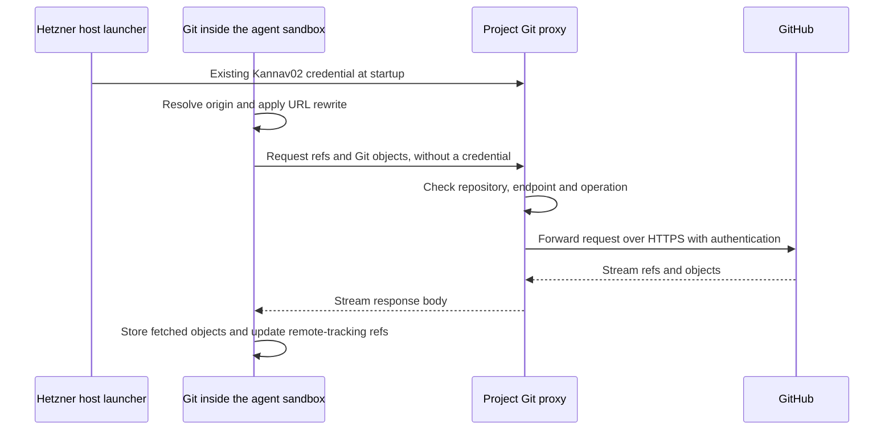

# Git proxy

The Git proxy is a sidecar service that gives the sandbox access to its mapped GitHub repository using the host's existing credential. It checks each Git network request, adds authentication, forwards it to GitHub, and streams the response back.

It intercepts **network requests produced by Git**, not shell commands. Commands such as `git status`, `git diff` and `git commit` stay local. Git resolves `origin`; the proxy never reads the project's remote configuration or executes Git commands.

## Example: `git fetch origin`

The agent runs:

```sh
git fetch origin
```

Git reads the existing `origin` URL from the repository:

```text
git@github.com-kannav02:maraja/gem-research-suite.git
```

The container's Git `insteadOf` configuration replaces the prefix automatically:

```text
git@github.com-kannav02:  →  http://git-proxy:8081/

Actual destination:
http://git-proxy:8081/maraja/gem-research-suite.git
```

This configuration comes from the container's `GIT_CONFIG_*` environment variables. The stored `origin` URL and read-only `.git/config` remain unchanged. The deployed configuration also rewrites GitHub HTTPS URLs and the other SSH URL forms listed in [the Compose override](../deploy/git-proxy-alpha.yaml).



For this project, the proxy is configured with:

```text
GITHUB_REPOSITORY=maraja/gem-research-suite
```

It accepts fetch discovery at:

```http
GET /maraja/gem-research-suite.git/info/refs?service=git-upload-pack
```

Git then exchanges protocol messages through `POST /maraja/gem-research-suite.git/git-upload-pack`. The proxy forwards the same path to `https://github.com`. A request for a different repository returns `403` without reaching GitHub.

## What authentication gets added?

The [host launcher](../deploy/with-git-credential.sh) reads the existing Kannav02 login through `gh` as `devuser` on Hetzner. It supplies that token to the proxy container at startup. The agent container receives no token, SSH key or host home-directory mount.

The proxy constructs this header for GitHub:

```text
Authorization: Basic BASE64("x-access-token:" + EXISTING_GITHUB_TOKEN)
```

`BASE64(...)` above describes the encoding, not a literal header value. HTTPS protects the outbound connection; Base64 itself is not encryption. Caller authentication headers are ignored. The proxy supplies the Git content type and preserves supported gzip encoding and Git protocol-v2 negotiation.

Request and successful response bodies are piped through as streams. The proxy does not store a checkout or buffer the entire repository. It returns Git data to the agent, not the authentication header. Recreate the proxy through the launcher after rotating the host credential.

## Fetch, push and boundaries

| Operation | Behavior |
| --- | --- |
| Local Git commands | Run inside the sandbox; no proxy request. |
| Fetch, clone, or the fetch part of pull | Use the mapped repository's `git-upload-pack` endpoints. |
| Normal push | Uses `git-receive-pack`; permitted only when `GIT_ALLOW_PUSH=1`. |
| Open or find a pull request | `GET /repos/<owner>/<repo>` (default branch), `GET …/pulls?head=<owner>:jeff/<slug>&state=open` and `POST …/pulls` from a `jeff/*` head into a different base, forwarded to `https://api.github.com` with only title, body, head and base; permitted only when `GIT_ALLOW_PULL_REQUESTS=1`. |
| Different repository or unsupported endpoint | Rejected with `403`. |
| Upstream redirect or non-200 response | Not followed; returns a generic `502`. |

The sidecar has no published host port and joins its project's Docker network. For research, `git-proxy` resolves to `172.30.1.254`. The host credential can access multiple repositories, but this proxy accepts only the configured repository. Host administrators and Docker can inspect the sidecar credential; the agent container cannot.

The URL rewrite is routing configuration, not a universal network interception mechanism. General outbound networking remains available; bypassing the proxy does not give the agent the host credential. LFS, submodule workflows and other repositories require separate support.

Shell approval policy is separate from this service. It blocks explicit force-push command variants; the proxy does not inspect commit ancestry. As deployed on 2026-10-14, the owner accepted command-policy-only protection and enabled normal pushes because GitHub's current private-repository plan does not support the requested server rules. Direct Git protocol requests could bypass that command check.

## Pull requests

The safety plugin's `open_pull_request` tool (`plugin/src/pull-request.ts`) uses these calls through `GIT_PROXY_URL`, which the Compose overrides give the agent container. It reads the session's branch and `origin` with read-only Git, refuses the default branch and branches outside `jeff/`, and returns the branch's open pull request or opens one into the default branch. It asks no one: OpenCode plugin tools never reach the permission hook. The agent can also call the proxy directly, so the proxy's checks are the boundary. The host GitHub account (Kannav02) authors the pull requests. Bodies over 64 KiB get `413`, GitHub errors become a `502` naming only the status, and replies carry only `default_branch`, `html_url` and `number` (repository JSON can include a temporary clone token). `tests/pull-request.integration.test.ts` covers these calls; there `GIT_UPSTREAM` (127.0.0.1 only) serves both Git and the REST API.

## Deployment and verification

See [deployment setup](deploy.md#private-github-repositories-opt-in) for fixed and registered projects. Research fetch and normal push were verified through Slack using a disposable branch, which was then removed; see [deployment findings](findings.md#git-proxy-and-approval-deployment-2026-10-14-toronto). Automated proxy coverage is tracked in [issue #36](https://github.com/Kannav02/slack-tag/issues/36).
