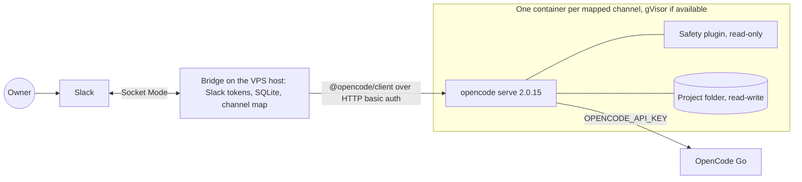

# Slack Tag build plan

Policy update (2026-09-27): policy version 2 automatically allows actions that previously asked for approval. The existing `git push`, `sudo`, and protected-file blocks remain. Rebuild the OpenCode image and restart the bridge together because their policy versions must match. Earlier approval scenarios below document the original implementation, not the current deployment policy.

The shared plan for building Slack Tag V1. The owner starts one cloud agent per slice by pasting the slice's prompt. Each slice ends with a manual verification checklist. A slice is done only when someone has run that checklist against the real system and recorded the result in the status table.

Read `SPEC.md` for requirements and `docs/findings.md` for the evidence behind the design. This file holds the design summary, the decisions, and the slices.

## Status

Agents update their row when they start, open a PR, and finish verification. Status is one of `not started`, `in progress`, `needs owner check`, `verified`, or `blocked: <reason>`.

| Slice | Status | Branch or PR | Verified by, date |
| --- | --- | --- | --- |
All six slices are integrated in one branch, `cursor/slack-tag-debloat-376f` ([PR #3](https://github.com/Kannav02/slack-tag/pull/3)), which replaces the separate slice branches. "Router" below means the checks drove the bridge's message, click, and event handlers against real OpenCode 2.0.15 servers, with a recorder in place of the Slack Web API. No Slack app tokens were available, so nothing was posted to Slack.

| Slice | Status | Branch or PR | Verified by, date |
| --- | --- | --- | --- |
| S1. Verify the safety plugin on OpenCode 2.0.15 | needs owner check | PR #3 | agent, 2026-09-25. Steps 1 to 6 rerun after the policy rewrite. Steps 7 and 8 from the S1 run. |
| S2. Run a text conversation from Slack | needs owner check | PR #3 | agent, 2026-09-25. Steps 1 to 10 through the router with `opencode-go/kimi-k2.7-code`. Live Slack posts need the owner. |
| S3. Approve or reject actions from Slack | needs owner check | PR #3 | agent, 2026-09-25. Steps 1 to 10 through the router with the fake model. Button clicks in Slack need the owner. |
| S4. Send attachments to the agent | needs owner check | PR #3 | agent, 2026-09-25. Steps 1 to 8 through the router with Kimi and `glm-5.2`. Real Slack uploads need the owner. |
| S5. Isolate each channel in a container | needs owner check | PR #3 | agent, 2026-09-25. Steps 1 to 10 under `runsc` through the router. Live Slack posts need the owner. |
| S6. Deploy to the VPS and run the real Go smoke | needs owner check | PR #3 | Unit, env templates, and `docs/deploy.md` written. No VPS access, so every step needs the owner. |

## How to run a slice

1. Check that every slice it depends on is `verified` and merged.
2. Check that the slice's secrets are set in Cursor Dashboard > Cloud Agents > Secrets. See "Secrets and environment".
3. Start a cloud agent on the default branch and paste the slice's prompt.
4. When the agent reports, run any checklist steps it marked `needs owner`. These are usually button clicks or steps as a second Slack user.
5. Record the result in the status table, then merge.

Every slice follows the same rules:

- Work in poteto mode (`/poteto-mode`). Skip its steps that write or run automated tests.
- No automated tests and no test files. Verification is the slice's manual checklist.
- Never print, log, or commit a secret. Refer to secrets by variable name only.
- Pin every `@opencode/*` package and the server to 2.0.15. The latest release is 2.0.16, and the docs describe the latest.
- Keep code small. The whole of V1 is about 1.5k to 2.5k lines of TypeScript.
- Record anything learned about OpenCode, Slack, or the runtime in `docs/findings.md`.

## Design summary



### Bridge

The bridge is a Node.js and TypeScript process on the VPS host. It holds the Slack tokens and connects with Socket Mode. It accepts messages and button clicks only from the configured owner. A fixed config file maps each channel to a project, and the bridge refuses unmapped channels.

For each mapped channel, the bridge talks to that channel's OpenCode server with `@opencode/client` 2.0.15. It authenticates with HTTP basic auth, username `opencode` and password `OPENCODE_SERVER_PASSWORD`.

- A mention at the top level of a mapped channel starts a thread and calls `session.create`.
- A reply in a bound thread calls `session.prompt` on the same session.
- The bridge streams `session.text.delta` into one Slack message with rate-limited edits.
- On `session.execution.succeeded`, `.failed`, or `.interrupted`, the bridge posts the final text or a visible failure.
- On `permission.asked`, the bridge posts Approve and Reject buttons. Approve sends `once`. Reject and the timeout send `reject`. The bridge never sends `always`. On restart it rebuilds pending prompts from `permission.list`.
- Attachments go into a per-thread inbox inside the project and reach the agent as `files: [{ uri: "file://..." }]`. The bridge sends an image only when the model's `capabilities.input` includes `image`.
- At startup the bridge calls the safety plugin's RPC for each channel. If the plugin or its policy version is missing, that channel is unavailable and mentions get a reply saying so.

### Per-channel container

Each mapped channel has one container that runs `opencode serve` 2.0.15. Mounts:

- The channel's project folder, read-write.
- Its own OpenCode data volume, so sessions survive restarts.
- The global OpenCode config and the safety plugin, read-only.
- The project's `.opencode/` directory and `opencode.json` and `opencode.jsonc`, read-only. OpenCode loads plugins from `.opencode/plugins/` and from a project config's `plugins` list, so the agent must not be able to write either.

The container receives `OPENCODE_API_KEY` and `OPENCODE_SERVER_PASSWORD`. It never receives Slack tokens. The server port is reachable only from the host.

### Safety plugin

A small OpenCode v2 server plugin, loaded from the global config. It uses `Plugin.define({ id, setup(ctx) })` from `@opencode/plugin` 2.0.15.

- `ctx.permission.hook("evaluate")` applies the allow, ask, and deny policy. The hook runs after config rules and only for `allow` and `ask` results. A configured `deny` is final and skips the hook.
- `ctx.shell.hook("create.before")` removes `OPENCODE_API_KEY`, `OPENCODE_SERVER_PASSWORD`, and any `SLACK_*` variable from agent shell environments.
- `ctx.session.hook("context")` may tell the model that it is talking through Slack and where attachments are. This is optional.
- An RPC defined with `Rpc.define`, id `slack-tag`, method `status`, returns the plugin version and the policy version. It is served at `POST /api/rpc/slack-tag/status`. The bridge reads it through `client.rpc(...)`.

Plugin docs: [Plugins](https://opencode.ai/v2/docs/build/plugins) and [RPC](https://opencode.ai/v2/docs/build/plugins/rpc/). The 2.0.15 package declares these hooks and the `rpc` export, but their runtime behaviour on 2.0.15 is unverified. S1 verifies it.

### Proposed repository layout

- `plugin/` is the safety plugin. `plugin/src/rpc.ts` holds the RPC definition, and the bridge imports it.
- `bridge/` is the bridge.
- `deploy/` holds the container image, the Compose file, the global OpenCode config, and the systemd unit.
- `config/example.json` is an example bridge config.

The bridge targets Node.js 22.18 or later, which runs TypeScript by type stripping and includes `node:sqlite`. Slack uses `@slack/bolt` in Socket Mode. These are proposed defaults. S2 may change them and must record why.

### Bridge config and stored state

The config file path comes from `SLACK_TAG_CONFIG`. `projectDir` is the path the bridge writes to on the host. `serverDir` is the same folder as the OpenCode server sees it, and it defaults to `projectDir` when no container is used.

```json
{
  "ownerUserId": "U0123456789",
  "approvalTimeoutMinutes": 30,
  "channels": {
    "C0123456789": {
      "name": "notes",
      "projectDir": "/srv/slack-tag/projects/notes",
      "serverDir": "/project",
      "opencodeUrl": "http://127.0.0.1:4101",
      "model": "opencode-go/kimi-k2.7-code"
    }
  }
}
```

SQLite holds three tables:

| Table | Key | Holds |
| --- | --- | --- |
| `threads` | `team_id`, `channel_id`, `thread_ts` | `session_id`, creation time |
| `approvals` | `request_id` | `session_id`, `channel_id`, `thread_ts`, Slack `message_ts`, state `pending`, `approved`, `rejected`, or `expired`, asked and decided times |
| `replies` | Slack `message_ts` | `session_id`, `channel_id`, state `streaming`, `done`, or `failed` |

After a restart, a reply still marked `streaming` is edited to say the bridge restarted during the run. The SPEC does not promise that an in-flight run continues.

## Decisions

### Decided

- Bridge on the VPS host in Node.js and TypeScript, Slack Socket Mode, owner-only messages and clicks, a fixed channel-to-project config, and SQLite for thread links, pending approvals, and Slack message ids.
- OpenCode v2 2.0.15 through `@opencode/client`, one server per mapped channel, HTTP basic auth.
- Approve sends `once`. Reject and timeout send `reject`. The bridge never sends `always`.
- One container per mapped channel, gVisor if available, only that project mounted read-write, and `.opencode/` and project config read-only. No Slack tokens in the container.
- A safety plugin loaded from the global config enforces policy, strips secrets from agent shells, and reports its policy version over RPC.
- No egress proxy in V1. The Go key reaches the container as an environment variable, and the plugin strips it from agent shells. This stops casual leaks, not a determined agent. A proxy can come later. This settles findings open questions 2 and 4 for V1.
- No automated tests. Each slice has a manual verification checklist.

### Proposed defaults, not yet agreed by the owner

Slices use these until the owner changes them. Each is one config value or one policy row.

- Default model `opencode-go/kimi-k2.7-code`.
- `git push` is hard-denied through the global config's `experimental.policies`.
- A message sent while the session is busy uses `delivery: "queue"`.
- Owner replies in a bound thread continue the session without a mention.
- Approvals auto-reject after 30 minutes.
- Fixed Docker Compose services, one per channel.
- A non-owner mention or click gets a short ephemeral reply and runs nothing.
- One `OPENCODE_SERVER_PASSWORD` shared by all channel servers, since each port listens only on the host.

The starting policy, which S1 turns into config rules and plugin rules:

| Action | Effect |
| --- | --- |
| Read, list, and search inside the project | allow |
| Edit and write inside the project | allow |
| Edit `.opencode/**`, `opencode.json`, `opencode.jsonc`, `.git/hooks/**`, `.git/config` | deny |
| Shell commands other than the hard blocks below | allow |
| Shell `git push *` | deny, hard |
| Shell `sudo *` | deny |
| Web fetch and web search | allow |
| Anything else | allow |

Command-name matching is intent control, not a security boundary. The container is the boundary.

### Owner-only unknowns

VPS size, whether `/dev/kvm` exists, whether Docker is installed, where project folders live, and whether private channels are used. S1 to S5 do not need these. S6 resolves them.

## Secrets and environment

Put secrets in Cursor Dashboard > Cloud Agents > Secrets. On the VPS they live in root-only env files that S6 creates.

Use a separate Slack app for cloud agents, for example "OpenCode (dev)" in a test workspace. Socket Mode splits events between every connection that uses the same app token, so a cloud agent's bridge and the VPS bridge must not share one.

The Slack app needs Socket Mode, interactivity, the bot events `app_mention`, `message.channels`, and `message.groups`, and the bot scopes `app_mentions:read`, `channels:history`, `groups:history`, `chat:write`, and `files:read`. Invite the bot to the test channels. The bridge reads mentions from `message` events, because those carry the uploaded files, so `app_mention` is subscribed but unused.

| Variable | What it is | Needed by |
| --- | --- | --- |
| `OPENCODE_API_KEY` | OpenCode Go key | S1 real-model step, S2 to S6 |
| `OPENCODE_SERVER_PASSWORD` | Basic auth password for `opencode serve`. Cloud agents may generate one locally. | S1 to S6 |
| `SLACK_BOT_TOKEN` | Bot token, `xoxb-` | S2 to S6 |
| `SLACK_APP_TOKEN` | App-level token, `xapp-`, scope `connections:write` | S2 to S6 |
| `SLACK_OWNER_ID` | The owner's Slack member id | S2 to S6 |
| `SLACK_TEST_CHANNEL_ID` | A channel mapped to the test project | S2 to S5 |
| `SLACK_UNMAPPED_CHANNEL_ID` | A channel the bot is in but that is not mapped | S2 |
| `SLACK_OWNER_USER_TOKEN` | Optional. The owner's user token, `xoxp-`, scopes `chat:write` and `files:write`. Lets an agent post messages and files as the owner. | S2 to S4 |
| `SLACK_OTHER_USER_TOKEN` | Optional. A second account's user token. Lets an agent post as a non-owner. | S2 to S4 |
| `VPS_SSH_HOST`, `VPS_SSH_KEY` | Only if an agent deploys | S6 |

Slack has no API to click a button as a user. Button checks need the owner in the Slack client, or an agent driving a Slack web session logged in as that user. Agents mark those steps `needs owner`.

## S1. Verify the safety plugin on OpenCode 2.0.15

**Goal.** Prove that the plugin hooks and RPC work on the pinned server, and produce the plugin and global config that later slices use.

**Depends on.** None.

**Covers.** Automatic actions and Restricted actions at the server level, without Slack. The secret-stripping part of Project isolation.

**In scope.**

- `plugin/` package with `@opencode/plugin` 2.0.15, the policy as one table in `plugin/src/policy.ts` with a `POLICY_VERSION` number, the `evaluate` and `create.before` hooks, and the `slack-tag` RPC.
- `deploy/opencode.global.jsonc`, which loads the plugin by path and holds the config permission rules and the `git push` hard deny.
- Whether project-level plugins load from `.opencode/plugins/` and from a project `opencode.json` `plugins` list on 2.0.15.
- The exact permission action names 2.0.15 emits for read, edit, shell, and web tools. Use `spike/v2/dump-events.mjs`.
- Findings recorded in `docs/findings.md`, including anything that differs from the docs.

**Out of scope.** Slack, the bridge, and containers. The `context` hook is optional here.

**Prompt.**

```text
You are building slice S1 of Slack Tag, a self-hosted Slack bridge to OpenCode. Read SPEC.md, docs/findings.md, and docs/plan.md in full first. Your task is the section "S1. Verify the safety plugin on OpenCode 2.0.15" in docs/plan.md.

Work on a new branch named cursor/slack-tag-s1-plugin-<suffix>. Use /poteto-mode, and skip its automated-test steps. Do not add automated tests or test files. Never print, log, or commit secrets. Refer to OPENCODE_API_KEY and OPENCODE_SERVER_PASSWORD by name only. Pin @opencode/plugin, @opencode/client, and @opencode/cli to exactly 2.0.15.

Build plugin/ and deploy/opencode.global.jsonc as the S1 section describes, using the starting policy table in docs/plan.md. The docs at https://opencode.ai/v2/docs/build/plugins describe a newer release, so check every hook against the 2.0.15 type definitions and against a running 2.0.15 server. Reuse spike/v2 (run.sh, mock-model.mjs, dump-events.mjs, real.sh) as manual tools to drive a server with the fake model or the real Go model.

When done, run every step of the S1 manual verification checklist yourself and record each result. Update the S1 row of the status table in docs/plan.md. Add what you learned to docs/findings.md: action names, whether project plugins load, and any hook behaviour that differs from the docs. If a hook does not work on 2.0.15, say so plainly and propose the fallback. Commit and push your branch.
```

**Manual verification.**

Start a 2.0.15 server the way `spike/v2/run.sh` does, with a throwaway home, the fake model, and `deploy/opencode.global.jsonc` as the global config. Set `OPENCODE_API_KEY=canary-not-a-real-key` in the server environment for steps 1 to 6. Drive prompts with `spike/v2/dump-events.mjs` or a short script. The fake model runs `RUN: <command>` as a shell call.

- [ ] 1. `curl -s -u opencode:$OPENCODE_SERVER_PASSWORD -X POST http://127.0.0.1:4096/api/rpc/slack-tag/status -H 'content-type: application/json' -d '{"input":{}}'` returns the plugin version and the `POLICY_VERSION` from `plugin/src/policy.ts`. Pass when both values match the source.
- [ ] 2. Send `RUN: ls`. Pass when the run ends with `session.execution.succeeded` and no `permission.asked` event.
- [ ] 3. Send `RUN: touch asked.txt`. Pass when a `permission.asked` event arrives and `asked.txt` does not exist 5 seconds later. Reply `reject` and confirm the file is still absent.
- [ ] 4. Send `RUN: git push origin main`. Pass when the tool fails with `Blocked by configuration policy` and no `permission.asked` event arrives.
- [ ] 5. Send `RUN: sudo ls`. Pass when the tool fails without a `permission.asked` event and the failure message comes from the plugin.
- [ ] 6. Send `RUN: env > env.txt` and reply `once`. Pass when `env.txt` exists and `grep -c 'OPENCODE_API_KEY\|OPENCODE_SERVER_PASSWORD' env.txt` prints `0`.
- [ ] 7. Put a minimal plugin that writes a marker file into the test project's `.opencode/plugins/` and restart the server. Record in findings whether the marker appears. Repeat with a project `opencode.json` `plugins` entry. Pass when both results are recorded. A "loads" result confirms the read-only mounts in S5.
- [ ] 8. Restart the server with the real key and `MODEL=opencode-go/kimi-k2.7-code`. Prompt "Use the shell to run exactly `echo KEY=${OPENCODE_API_KEY:-unset}`, then reply with its output." and reply `once`. Pass when the run succeeds and the reply is `KEY=unset`. This proves the server uses the key while the agent's shell cannot see it.

## S2. Run a text conversation from Slack

**Goal.** The owner mentions `@OpenCode` in a mapped channel and gets a streamed answer in the thread. Replies continue the session, and threads survive restarts.

**Depends on.** S1. The bridge imports the RPC definition from `plugin/src/rpc.ts`.

**Covers.** Owner-only access for messages. Channel routing. Thread sessions. Persistence. Streaming. The OpenCode adapter for messages and session continuation.

**In scope.**

- Config loading and validation from `SLACK_TAG_CONFIG`, and SQLite with the `threads` and `replies` tables.
- Socket Mode connection, owner check, and routing by channel. Unmapped channels get a refusal.
- A small adapter module that wraps `@opencode/client` behind the SPEC's agent interface. The interface covers creating a session, prompting it, receiving events, listing pending permissions, and replying to one.
- Streaming with rate-limited edits, at most about one edit per second per message. When a reply grows past about 3,500 characters, continue in a new message.
- A visible final state for succeeded, failed, and interrupted runs. A Go HTTP 429 names the retry time when OpenCode reports one.
- Busy sessions with `delivery: "queue"`. Confirm which event marks the start of a queued run, and stream that run into its own message.
- The plugin status check at startup, per channel.
- The OpenCode server runs as a plain host process, started the way `spike/v2/real.sh` starts it.

**Out of scope.** Approvals (S3), attachments (S4), containers (S5). Until S3, the test server's config may allow shell commands, or tests may avoid them.

**Prompt.**

```text
You are building slice S2 of Slack Tag, a self-hosted Slack bridge to OpenCode. Read SPEC.md, docs/findings.md, and docs/plan.md in full first. Your task is the section "S2. Run a text conversation from Slack" in docs/plan.md.

Work on a new branch named cursor/slack-tag-s2-bridge-core-<suffix>. Use /poteto-mode, and skip its automated-test steps. Do not add automated tests or test files. Never print, log, or commit secrets. Refer to SLACK_BOT_TOKEN, SLACK_APP_TOKEN, SLACK_*_USER_TOKEN, OPENCODE_API_KEY, and OPENCODE_SERVER_PASSWORD by name only, and keep them out of logs. Pin @opencode/client and @opencode/cli to exactly 2.0.15.

Build bridge/ as the S2 section and the design summary in docs/plan.md describe. Follow the config shape and the SQLite tables given there. Run OpenCode 2.0.15 as a local host process with deploy/opencode.global.jsonc and the plugin from S1, and write a local bridge config from SLACK_OWNER_ID, SLACK_TEST_CHANNEL_ID, and SLACK_UNMAPPED_CHANNEL_ID. Use the dev Slack app from the secrets, never the production app.

When done, run the S2 manual verification checklist as far as your environment allows. If SLACK_OWNER_USER_TOKEN and SLACK_OTHER_USER_TOKEN are set, post the Slack messages with them. Mark every step you could not run as "needs owner". Update the S2 row of the status table in docs/plan.md, and add what you learned to docs/findings.md. Commit and push your branch.
```

**Manual verification.**

Create a test project with `AGENTS.md` containing "End every reply with the word PINEAPPLE." and `facts.txt` containing "The project codename is HERON." Start OpenCode with the real key and the default model. Map `SLACK_TEST_CHANNEL_ID` to the project, then start the bridge. Read state with `sqlite3 <db> 'select channel_id, thread_ts, session_id from threads'`.

- [ ] 1. In the test channel, as the owner, post `@OpenCode what is the project codename in facts.txt?`. Pass when a thread reply appears, visibly grows through several edits, and ends with an answer that contains `HERON` and ends with `PINEAPPLE`. `threads` has one row for that thread.
- [ ] 2. In that thread, without a mention, post `Remember the word ORCHID.` Then post `Which word did I ask you to remember?`. Pass when the second answer contains `ORCHID` and `threads` still has one row for the thread with the same `session_id`.
- [ ] 3. At the top level, post `@OpenCode which word did I ask you to remember?`. Pass when a new thread starts, its answer does not contain `ORCHID`, and `threads` has a second row with a different `session_id`.
- [ ] 4. As a second Slack account, post `@OpenCode list the files` in the test channel, and post a reply in the first thread. Pass when neither starts a run, `threads` is unchanged, and the second account sees only an ephemeral refusal.
- [ ] 5. As the owner, post `@OpenCode hello` in the unmapped channel. Pass when the bot replies that the channel is not mapped to a project and `threads` is unchanged.
- [ ] 6. Stop the bridge and the OpenCode server. Start both again with the same database and data directory. In the first thread, post `Which word did I ask you to remember?`. Pass when the answer contains `ORCHID` and the thread's `session_id` is unchanged.
- [ ] 7. In the first thread, post `Write three short paragraphs about herons.` and, before it finishes, post `Then say QUEUED-OK.`. Pass when the second answer appears as its own message after the first run finishes and contains `QUEUED-OK`.
- [ ] 8. Restart OpenCode without `OPENCODE_API_KEY` and post a new mention. Pass when the thread shows a failure message that names the provider error, and nothing in the thread looks like a success.
- [ ] 9. Start the bridge against a server that runs without the safety plugin. Pass when the bridge log says the channel is unavailable and a mention gets a reply saying the project environment is unavailable.
- [ ] 10. Run `grep -rE 'xox[bpa]-|xapp-' <bridge log files>` and read the database dump. Pass when neither contains a token or the Go key.

## S3. Approve or reject actions from Slack

**Goal.** A restricted action waits for the owner. Approve runs it once. Reject, a timeout, or a non-owner click leaves it unexecuted.

**Depends on.** S2.

**Covers.** Restricted actions. Automatic actions. Owner-only access for approval clicks. Persistence of pending approvals. The OpenCode adapter for permission decisions.

**In scope.**

- A prompt with the action, the resources such as the command, and Approve and Reject buttons. The button value carries the session id and the request id.
- The `approvals` table. The prompt message updates to show who decided and how.
- Non-owner clicks and clicks on already-decided prompts run nothing and get an ephemeral reply.
- Timeout with `reject` after `approvalTimeoutMinutes`. The timeout survives a bridge restart because it is computed from the stored ask time.
- Rebuild pending prompts from `permission.list` on startup, reusing the stored Slack message when one exists.
- `reject` rejects every other pending request in the session, as the spike found. Update those prompts too.

**Out of scope.** Changing the policy, which is S1's table. Any "always allow" control.

**Prompt.**

```text
You are building slice S3 of Slack Tag, a self-hosted Slack bridge to OpenCode. Read SPEC.md, docs/findings.md, and docs/plan.md in full first. Your task is the section "S3. Approve or reject actions from Slack" in docs/plan.md.

Work on a new branch named cursor/slack-tag-s3-approvals-<suffix>. Use /poteto-mode, and skip its automated-test steps. Do not add automated tests or test files. Never print, log, or commit secrets. Refer to Slack tokens, OPENCODE_API_KEY, and OPENCODE_SERVER_PASSWORD by name only. Keep @opencode/* at exactly 2.0.15. The bridge must never send the "always" permission reply.

Extend bridge/ as the S3 section describes. Run OpenCode 2.0.15 as a local host process with deploy/opencode.global.jsonc and the S1 plugin, so the real policy applies. For deterministic runs you may use the fake model from spike/v2, where "RUN: <command>" makes a shell call. Use the real Go model for at least steps 1 and 2.

When done, run the S3 manual verification checklist as far as your environment allows. Button clicks need a Slack client, so mark click steps you could not perform as "needs owner" with exact instructions. Update the S3 row of the status table in docs/plan.md, and add what you learned to docs/findings.md. Commit and push your branch.
```

**Manual verification.**

Use the S2 setup. For a shorter timeout during step 6, set `approvalTimeoutMinutes` to `1`.

- [ ] 1. Post `@OpenCode use the shell to run exactly touch approved.txt, then reply DONE`. Pass when the thread shows a prompt naming `touch approved.txt` with Approve and Reject buttons, and `ls <project>/approved.txt` fails 10 seconds later.
- [ ] 2. Click Approve as the owner. Pass when the prompt changes to "Approved once" with the owner's name, `approved.txt` exists, and the thread answer contains `DONE`.
- [ ] 3. Repeat with `rejected.txt` and click Reject. Pass when the prompt shows "Rejected", `rejected.txt` does not exist, and the thread shows the run's end state.
- [ ] 4. Repeat with `other.txt`. Click Approve as the second account. Pass when that account sees an ephemeral refusal, the buttons stay active, and `other.txt` does not exist. Then click Reject as the owner.
- [ ] 5. Repeat with `pending.txt`. Stop the bridge before clicking, then start it. Pass when the thread has a working prompt for the same request, `approvals` shows it `pending`, and Approve creates `pending.txt`.
- [ ] 6. With the timeout at one minute, repeat with `timeout.txt` and wait 70 seconds. Pass when the prompt shows that it was rejected because nobody answered, `approvals` shows `expired`, and `timeout.txt` does not exist.
- [ ] 7. Click Approve on the prompt from step 2 again. Pass when nothing runs and the owner sees an ephemeral "already decided" reply.
- [ ] 8. Post `@OpenCode show me the first line of README.md`. Pass when the answer arrives with no approval prompt.
- [ ] 9. Post `@OpenCode run git push origin main in the shell`. Pass when no prompt appears and the answer reports that the command was blocked.
- [ ] 10. Run `grep -rn '"always"' bridge/`. Pass when it prints nothing.

## S4. Send attachments to the agent

**Goal.** Files and supported images uploaded in a thread reach the agent in that session. Unsupported inputs get a clear reply and cannot escape the inbox.

**Depends on.** S2. S3 is not required.

**Covers.** Attachments.

**In scope.**

- Download each file with the bot token into `<projectDir>/.slack-tag/inbox/<thread_ts>/`, and add `.slack-tag/` to the project's `.git/info/exclude`.
- Make the stored name from the Slack name's final path segment, restricted to a safe character set. Never overwrite an existing file. Add a suffix instead. Check that the resolved path is inside the inbox before writing.
- Pass files as `file://` URIs built from `serverDir`, not `projectDir`.
- Check the channel model's `capabilities.input` before sending an image. Record which file types 2.0.15 accepts, and give every other type a clear reply.
- A size limit, proposed at 20 MB per file.
- Optionally, the `context` hook in the plugin tells the model it is in Slack and where the thread's inbox is.

**Out of scope.** Uploading generated files back to Slack.

**Prompt.**

```text
You are building slice S4 of Slack Tag, a self-hosted Slack bridge to OpenCode. Read SPEC.md, docs/findings.md, and docs/plan.md in full first. Your task is the section "S4. Send attachments to the agent" in docs/plan.md.

Work on a new branch named cursor/slack-tag-s4-attachments-<suffix>. Use /poteto-mode, and skip its automated-test steps. Do not add automated tests or test files. Never print, log, or commit secrets. Refer to Slack tokens, OPENCODE_API_KEY, and OPENCODE_SERVER_PASSWORD by name only, and never put a token in a logged URL. Keep @opencode/* at exactly 2.0.15.

Extend bridge/ as the S4 section describes. Filenames from Slack are untrusted input. Use the real Go model opencode-go/kimi-k2.7-code, which accepts images, and opencode-go/glm-5.2, which accepts text only, for the unsupported-image check.

When done, run the S4 manual verification checklist as far as your environment allows. If SLACK_OWNER_USER_TOKEN is set, upload files with it. Mark steps you could not run as "needs owner". Update the S4 row of the status table in docs/plan.md, and add what you learned to docs/findings.md. Commit and push your branch.
```

**Manual verification.**

Use the S2 setup. Make a solid blue PNG named `sample.png` and a text file `notes.txt` containing "The secret word is MAPLE."

- [ ] 1. Upload `sample.png` with the message `@OpenCode what colour is this image? One word.`. Pass when the answer is `Blue` and the file exists at `<project>/.slack-tag/inbox/<thread_ts>/sample.png`.
- [ ] 2. In the same thread, upload `notes.txt` with `What is the secret word in this file?`. Pass when the answer contains `MAPLE`.
- [ ] 3. Upload `sample.png` again in the same thread. Pass when both copies exist in the inbox under different names and the first copy is unchanged.
- [ ] 4. Change the channel model to `opencode-go/glm-5.2`, restart the bridge, and upload `sample.png` with a mention. Pass when the bot replies that this model cannot read images, names the model, and no run starts.
- [ ] 5. Upload a type that 2.0.15 does not accept, according to the S4 findings, for example a `.zip`. Pass when the bot gives a clear reply and no run starts.
- [ ] 6. With the owner's user token, upload a file with the filename `../../escape.txt` into a thread with a mention. Pass when no `escape.txt` exists outside the inbox (`find <project>/.. -name 'escape*'` shows only the copy inside the inbox) and the stored name has no path separators.
- [ ] 7. As the second account, upload a file in a bound thread. Pass when no file is written and no run starts.
- [ ] 8. Run `git -C <project> status --short`. Pass when `.slack-tag/` does not appear.

## S5. Isolate each channel in a container

**Goal.** Each mapped channel's OpenCode server runs in its own container that can reach its own project and nothing else of consequence on the host.

**Depends on.** S1 and S2. Rerun the S3 and S4 checks in containers when those slices are merged.

**Covers.** Project isolation.

**In scope.**

- `deploy/Dockerfile` that installs `@opencode/cli` 2.0.15 and runs `opencode serve` as a non-root user.
- `deploy/compose.yaml` with one service per channel. Use `runtime: runsc` when gVisor is installed, and record the fallback when it is not.
- Mounts as the design summary lists. The start step creates `.opencode/`, `opencode.json`, and `opencode.jsonc` placeholders in the project when they are missing, so the read-only mounts always exist.
- Decide how to protect `.git/hooks/` and `.git/config` from shell writes. Git hooks run on the host if the owner later runs git in the project folder. Record the decision.
- `cap_drop: [ALL]`, `no-new-privileges`, no Docker socket, memory and process limits, and the server port published on `127.0.0.1` only.
- File ownership so that the bridge can write the inbox and the container user can read it.
- The bridge config uses `serverDir: "/project"` for container channels.

**Out of scope.** An egress proxy, per the no-proxy V1 decision. Starting containers on demand from the bridge.

**Prompt.**

```text
You are building slice S5 of Slack Tag, a self-hosted Slack bridge to OpenCode. Read SPEC.md, docs/findings.md, and docs/plan.md in full first. Your task is the section "S5. Isolate each channel in a container" in docs/plan.md.

Work on a new branch named cursor/slack-tag-s5-containers-<suffix>. Use /poteto-mode, and skip its automated-test steps. Do not add automated tests or test files. Never print, log, or commit secrets. Refer to Slack tokens, OPENCODE_API_KEY, and OPENCODE_SERVER_PASSWORD by name only, and pass them through env files that are not committed. Keep @opencode/* at exactly 2.0.15.

Build deploy/ as the S5 section describes. Install Docker if your environment lacks it. Try gVisor (runsc). If it cannot run in your environment, verify with runc and record that the VPS check in S6 must repeat the isolation steps under runsc.

When done, run the S5 manual verification checklist and record each result, including the output of docker inspect for the mounts, runtime, capabilities, and published ports. Mark Slack steps you could not run as "needs owner". Update the S5 row of the status table in docs/plan.md, and add what you learned to docs/findings.md. Commit and push your branch.
```

**Manual verification.**

Create two projects, `alpha` and `beta`, under one parent folder. Put `beta-secret.txt` containing "BETA-SECRET" in `beta`. Put a file containing `SLACK_BOT_TOKEN=placeholder` at the host path where the bridge env file will live. Start only the `alpha` service and map the test channel to it.

- [ ] 1. Run `docker inspect` on the `alpha` container. Pass when the runtime is `runsc` or the recorded fallback, the user is not root, `CapDrop` includes `ALL`, the port binds to `127.0.0.1` only, and the mounts are exactly the project read-write, the data volume, and the read-only config, plugin, `.opencode/`, `opencode.json`, and `opencode.jsonc`.
- [ ] 2. In Slack, post `@OpenCode create hello.txt containing hi`. Pass when `<alpha>/hello.txt` exists on the host with the content `hi`.
- [ ] 3. Post `@OpenCode use the shell to run ls ../beta; cat ../beta/beta-secret.txt` and approve. Try the absolute host path of `beta` too. Pass when every attempt fails and no answer contains `BETA-SECRET`.
- [ ] 4. Post `@OpenCode use the shell to run env` and approve. Pass when the output has no `OPENCODE_API_KEY`, no `OPENCODE_SERVER_PASSWORD`, and no `SLACK_` variable.
- [ ] 5. Post `@OpenCode use the shell to cat` the host path of the bridge env file, and approve. Pass when the file is not found.
- [ ] 6. Post `@OpenCode use the shell to run mkdir -p .opencode/plugins && echo x > .opencode/plugins/x.ts; echo '{}' > opencode.json` and approve. Pass when both writes fail with a read-only error and the host files are unchanged.
- [ ] 7. Post `@OpenCode use the shell to run mount -t tmpfs none /mnt` and approve. Pass when it fails with a permission error.
- [ ] 8. Upload `sample.png` from S4 in a thread. Pass when the answer is `Blue`, which proves that `serverDir` URIs resolve inside the container.
- [ ] 9. Run `docker compose restart alpha`, then reply in an earlier thread `What file did you create earlier?`. Pass when the answer mentions `hello.txt`.
- [ ] 10. Run `docker exec <alpha> env`. Pass when no `SLACK_` variable is present.

## S6. Deploy to the VPS and run the real Go smoke

**Goal.** Slack Tag runs on the owner's VPS with the production Slack app, survives a reboot, and passes the acceptance table end to end with the real Go model.

**Depends on.** S1 to S5.

**Covers.** Every row of the SPEC acceptance table, shown again on the VPS.

**In scope.**

- Resolve the owner-only unknowns and record them in `docs/findings.md`. These are VPS size, `/dev/kvm`, Docker, the project folder location, and private channels. gVisor's default platform does not need `/dev/kvm`.
- `deploy/slack-tag.service`, a systemd unit for the bridge, and a Compose restart policy for the containers.
- Root-only env files for the bridge (Slack tokens, server password) and for the containers (Go key, server password). Mode `0600`.
- `docs/deploy.md` with install, update, and rollback steps.

**Out of scope.** New features. A failing check becomes a fix in the slice that owns the feature.

**Prompt.**

```text
You are building slice S6 of Slack Tag, a self-hosted Slack bridge to OpenCode. Read SPEC.md, docs/findings.md, and docs/plan.md in full first. Your task is the section "S6. Deploy to the VPS and run the real Go smoke" in docs/plan.md.

Work on a new branch named cursor/slack-tag-s6-deploy-<suffix>. Use /poteto-mode, and skip its automated-test steps. Do not add automated tests or test files. Never print, log, or commit secrets, and never copy them into the repository or into command lines that are logged. Keep @opencode/* at exactly 2.0.15.

Write deploy/slack-tag.service, the env file templates without values, and docs/deploy.md. If VPS_SSH_HOST and VPS_SSH_KEY are set, deploy to the VPS and run the S6 checklist there. Otherwise write docs/deploy.md so the owner can run it, and mark every checklist step "needs owner". Do not reboot or change the VPS beyond what docs/deploy.md describes without the owner's confirmation.

When done, update the S6 row of the status table in docs/plan.md, and record the owner-only unknowns and anything else you learned in docs/findings.md. Commit and push your branch.
```

**Manual verification.**

Run on the VPS with the production Slack app and real project folders. Use a disposable project for the destructive steps.

- [ ] 1. Run `systemctl status slack-tag` and `docker compose ps`. Pass when the bridge is active, every channel container is running, and the bridge log reports the plugin check passed for every channel.
- [ ] 2. Rerun S2 steps 1 to 5. Pass when every step passes.
- [ ] 3. Rerun S3 steps 1 to 4, 8, and 9. Pass when every step passes.
- [ ] 4. Rerun S4 steps 1 and 4. Pass when both pass.
- [ ] 5. Rerun S5 steps 1 and 3 to 7 under `runsc`, or record why the VPS cannot run gVisor. Pass when every step passes.
- [ ] 6. Reboot the VPS. Pass when the bridge and containers come back without manual steps, and a reply in an earlier thread continues its conversation.
- [ ] 7. Trigger an approval, restart only the bridge, then approve. Pass when the command runs once.
- [ ] 8. Run `ls -l` on the env files and `ps -eo args | grep -E 'xox|xapp'`. Pass when the env files are `-rw-------` owned by root and no process argument contains a token.

## Appendix A. Alternatives rejected

- An egress proxy that injects the Go key. It would keep the key out of the container, but it adds a service, and Go requires OpenCode's own headers to pass through. Deferred to after V1.
- Containers started on demand by the bridge. The bridge would need the Docker socket, which is host root. Fixed Compose services avoid that.
- Policy only in config rules. A project `opencode.json` could add rules, and command matching needs code. The plugin's `evaluate` hook runs after config rules, and global `experimental.policies` stay the hard denies.
- Automated behavioural tests. The owner chose manual checks per slice.

## Appendix B. Risks

- The plugin hooks may behave differently on 2.0.15 than the docs say. S1 finds out first, and later slices depend on S1.
- Stripping the key from shells does not stop an agent that reads `/proc/1/environ` or asks the server itself. S1 and S5 record what the agent can still reach. The fix is the deferred proxy.
- Allowed shell commands such as tests run arbitrary project code. The container is the boundary, so S5 matters more than the policy table.
- Git hooks written by the agent run on the host if the owner runs git in the project folder. S5 decides the protection.
- Go usage limits return HTTP 429. S2 must show the retry time instead of a generic failure.
- A second bridge on the same Slack app token steals events. Cloud agents use the dev app.
