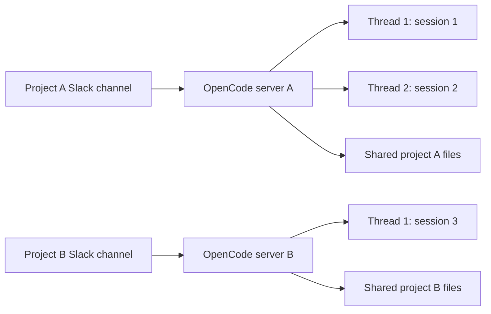

# Projects, servers, and conversations

One configured Slack channel selects one project and its OpenCode server. Each Slack thread has its own OpenCode session on that server. A new thread does **not** create another server or container.

Mention `@OpenCode` to start a conversation. Once a thread is mapped, owner replies in it continue the same session without another mention. Separate sessions do not import each other's conversation history, but share their project's files and Git working tree. Concurrent edits can therefore conflict; there are no worktrees or file locks per thread.

## Where the mapping lives

- `/var/lib/slack-tag/config.json`: Slack channel ID → project host path (`projectDir`), container path (`serverDir`), server URL (`opencodeUrl`), and model. The bridge reads this at startup.
- `/var/lib/slack-tag/slack-tag.sqlite`: Slack workspace ID + channel ID + thread timestamp → OpenCode session ID.
- Each container's persistent `/data` volume: OpenCode's conversation data. Retain both this volume and SQLite to resume conversations after restarts.
- The project bind mount: files edited by every session in that project. Host and container paths expose the same files; this is not a separate copy inside Docker.

Do not repoint an existing channel at a different server or replace its data volume casually: its saved thread mappings still refer to the original server's sessions. Use a new channel for a new project.

## First deployed project

Recorded deployment on 2026-09-27; see the first live VPS deployment section in [verification findings](findings.md) for checks and limitations.

| Setting | Value |
| --- | --- |
| Slack channel | Private `gem-research-suite` in Kannav Work |
| Project folder on VPS | `/home/devuser/projects/gem-research-suite` |
| Project folder inside container | `/project` |
| Compose service | `alpha` |
| OpenCode API | `http://127.0.0.1:4101` |
| Model | `opencode-go/kimi-k2.7-code` |
| Compose data volume key | `alpha-data`, mounted at `/data` |
| Application / Compose file | `/opt/slack-tag` / `/opt/slack-tag/deploy/compose.yaml` |

The single `slack-tag` bridge service routes all configured channels. Adding another project does not require another Slack app or bridge process.

## Adding a project today: manual

There is no onboarding command or UI yet. An operator must:

1. Put the project on the VPS and ensure the bridge and container user can access the required files. A VPS checkout does not automatically synchronize with a Mac checkout.
2. Create a Slack channel, invite OpenCode, and obtain its channel ID.
3. Run `deploy/prepare-project.sh <project folder>` from the application checkout. This creates attachment storage and any missing configuration files needed for read-only mounts; inspect the resulting project changes.
4. Copy the `beta` service in `deploy/compose.yaml`, preserving its isolation settings and protected mounts. Give it a unique service name, loopback host port, project variable, and data volume; declare the volume in the top-level `volumes` section. Remove `profiles: [extra]` or explicitly enable that profile when starting it.
5. Set the project path and port variables in the Compose environment file. The current VPS uses `/etc/slack-tag/compose.env`, passed explicitly with `docker compose --env-file /etc/slack-tag/compose.env -f /opt/slack-tag/deploy/compose.yaml`. Add the channel entry to `/var/lib/slack-tag/config.json`, following `config/example.json`: host path in `projectDir`, `/project` in `serverDir`, and the matching localhost port in `opencodeUrl`.
6. Start the new Compose service and restart `slack-tag` to load the mapping. Follow [deployment instructions](deploy.md) for service management and credential handling.
7. Verify a real Slack mention reads the intended project, a reply retains context, a separate thread starts fresh, and the original thread resumes after a restart with storage retained.

## Future: make onboarding easier

Planned, **not implemented**: one guided operator flow taking a project folder and Slack channel, validating access and duplicate mappings, preparing mounts, allocating a port and volume, updating configuration, starting the server, and checking readiness. It should preserve existing sessions and credentials and recover cleanly from partial setup failures. The exact command or UI is still to be decided.

Acceptance: a second project can be connected without hand-editing Compose or JSON; the flow reports success only after readiness checks and provides a concrete Slack conversation check. Re-running it must not duplicate containers or overwrite existing project data.
