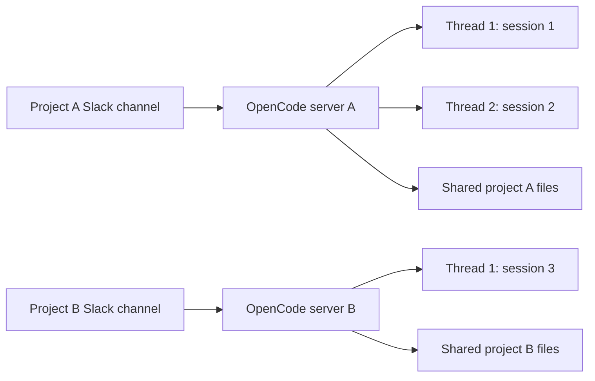

# Projects, servers, and conversations

One configured Slack channel selects one project and its OpenCode server. Each Slack thread has its own OpenCode session on that server. A new thread does **not** create another server or container.

Mention `@OpenCode` to start a conversation. Once a thread is mapped, owner replies in it continue the same session without another mention. Separate sessions do not import each other's conversation history, but share their project's files and Git working tree. To keep edits from colliding, the bridge runs one prompt at a time per working directory and queues the rest in arrival order.

## Per-thread worktrees (opt-in)

A channel with `"worktrees": true` in `config.json` gives each **new** thread its own Git worktree on a `jeff/<slug>` branch (the slug is derived from the thread timestamp), created inside the project container. Those threads run concurrently — one queue per worktree instead of one per project — and their edits no longer collide in the shared checkout. Threads mapped before the channel was switched on keep the shared `/project` checkout and still take turns there; there is no migration. The OpenCode session is created with `location` pointing at the worktree, so `/stop`, `/compact`, `/model`, approvals, progress cards and uploads work unchanged.

The worktree is created by the safety plugin in the server (the bridge never writes to a project folder), via `git worktree add -b jeff/<slug>` under `SLACK_TAG_WORKTREE_DIR`, outside `/project`, so worktrees never appear as untracked files in the main checkout. Removing merged worktrees, per-thread dev-server ports, and opening pull requests are out of scope. Enabling worktrees requires the server-side settings in [deployment](deploy.md); if they are missing the plugin refuses and the thread falls back to `/project`.

## Where the mapping lives

- `/var/lib/slack-tag/config.json`: Slack channel ID → project host path (`projectDir`), container path (`serverDir`), server URL (`opencodeUrl`), and model, plus an optional `approvers` list of Slack user IDs who may approve or reject that channel's actions besides the owner (registration never sets it). The bridge reads this at startup.
- `/var/lib/slack-tag/slack-tag.sqlite`: Slack workspace ID + channel ID + thread timestamp → OpenCode session ID.
- Each container's persistent `/data` volume: OpenCode's conversation data. Retain both this volume and SQLite to resume conversations after restarts.
- `/var/lib/slack-tag/inbox/<channel name>/<thread_ts>/`: Slack uploads. Only the bridge writes here; the container sees it read-only at `/inbox`.
- The project bind mount: files edited by every session in that project. Host and container paths expose the same files; this is not a separate copy inside Docker.

Do not repoint an existing channel at a different server or replace its data volume casually: its saved thread mappings still refer to the original server's sessions. Use a new channel for a new project.

## First deployed project

### Current production mapping (2026-10-14)

| Slack channel | Channel ID | VPS project | Server | Default model |
| --- | --- | --- | --- | --- |
| Private `research` | `C0C979QND8S` | `/home/devuser/projects/gem-research-suite` | `127.0.0.1:4101` (`deploy-alpha-1`) | `opencode-go/claude-haiku-5-5` |
| `dogfooding-channel` | `C0C6NN5Q16G` | `/srv/slack-tag/projects/temp-ideas` | `127.0.0.1:4103` (`slack-tag-temp-ideas-opencode-1`) | `opencode-go/claude-haiku-5-5` |

Both project channels are private. The required public channel is now `general` (`C0C2YBS6P7U`), has no project mapping, and retains the earlier public research history. Internal configuration names remain `gem-research-suite` and `temp-ideas` to preserve upload inbox mounts. `social` and `new-channel` are archived. The obsolete verification project is archived under `/srv/slack-tag/archived-projects/deploy-verification`; its containers/network were removed, but its volume and conversation history were retained. New registrations also default to Haiku 5.5. Existing thread model selections are unchanged.

### Original deployment

Recorded deployment on 2026-09-27; see the first live VPS deployment section in [verification findings](findings.md) for checks and limitations.

| Setting | Value |
| --- | --- |
| Slack channel | Private `gem-research-suite` in Kannav Work |
| Project folder on VPS | `/home/devuser/projects/gem-research-suite` |
| Project folder inside container | `/project` |
| Compose service | `alpha` |
| OpenCode API | `http://127.0.0.1:4101` |
| Model | `opencode-go/kimi-k2.7-code` |
| Compose data volume key | `alpha-data`, mounted at `/data` |
| Application / Compose file | `/opt/slack-tag` / `/opt/slack-tag/deploy/compose.yaml` |

The single `slack-tag` bridge service routes all configured channels. Adding another project does not require another Slack app or bridge process.

## Adding a project manually

Use this for projects outside the registration folder, or when changing the original `alpha` service. An operator must:

1. Put the project on the VPS and ensure the bridge and container user can access the required files. A VPS checkout does not automatically synchronize with a Mac checkout.
2. Create a Slack channel, invite OpenCode, and obtain its channel ID.
3. Run `deploy/prepare-project.sh <project folder>` from the application checkout. This creates any missing configuration files needed for read-only mounts and gives group 1000 write access, which agent shells need; inspect the resulting project changes.
4. Copy the `beta` service in `deploy/compose.yaml`, preserving its isolation settings and protected mounts. Give it a unique service name, loopback host port, project variable, env file, network, `/inbox` mount, and data volume; declare the volume and network at the top level and add the network to `key-proxy`. Each network needs a bridge name starting with `st-` (so the firewall covers it) and its own subnet `172.30.N.0/24`; give `key-proxy` the address `172.30.N.2` on it and set the service's `extra_hosts` to `key-proxy:172.30.N.2`, because gVisor cannot use Docker's built-in DNS. Remove `profiles: [extra]` or explicitly enable that profile when starting it.
5. Set the project path and port variables in the Compose environment file. The current VPS uses `/etc/slack-tag/compose.env`, passed explicitly with `docker compose --env-file /etc/slack-tag/compose.env -f /opt/slack-tag/deploy/compose.yaml`. Add the channel entry to `/var/lib/slack-tag/config.json`, following `config/example.json`: host path in `projectDir`, `/project` in `serverDir`, the matching localhost port in `opencodeUrl`, and a new `passwordEnv` name. Create `/var/lib/slack-tag/inbox/<channel name>`, owned by the bridge's user, before starting the service. Put a new random password in the project's env file and the same value under that name in `bridge.env`.
6. Start the new Compose service and restart `slack-tag` to load the mapping. Follow [deployment instructions](deploy.md) for service management and credential handling.
7. Verify a real Slack mention reads the intended project, a reply retains context, a separate thread starts fresh, and the original thread resumes after a restart with storage retained.

## Adding a project from Slack

Requires an `onboarding` section in `config.json` (see `config/example.json`): `projectsRoot` is the only folder whose direct subfolders can be registered, `model` is used for new projects, and `firstPort` (default 4102) is the lowest host port to allocate. Without it, `register` replies that registration is not configured. The `slack-tag-opencode:2.0.15` image must already be built by `deploy/compose.yaml`.

1. Put the project folder in `projectsRoot` on the VPS (`/srv/slack-tag/projects`, owned by uid 1000; see [deployment](deploy.md)), create a Slack channel and invite OpenCode.
2. As the owner, post `@OpenCode register` in the channel. The bot lists the subfolders that no channel uses yet; symlinks and other entries are skipped.
3. Choose a folder. The bot updates the message as `deploy/start-project.sh` prepares the folder (`deploy/prepare-project.sh`, as uid 1000 when run as root) and starts the container; it then waits for OpenCode to answer with the safety plugin, and saves the channel. The channel works immediately; no bridge restart.

What gets created for a folder `app-one`:

| Item | Value |
| --- | --- |
| Compose project | `slack-tag-app-one`, from `deploy/project.yaml`: its own OpenCode container and `key-proxy` container, `slack-tag-app-one_data` volume and `slack-tag-app-one_default` network |
| Env file | `<config dir>/projects/app-one.env` (mode 0600): folder, port and a generated server password |
| Server | `http://127.0.0.1:<port>`, reachable only from the VPS itself |
| Channel entry | added to `config.json` with `serverDir` `/project` and `passwordFile` pointing at the env file; the password itself is stored only in the env file |

Each registered project gets its own server password and its own copy of the key proxy, which reads the Go key from `proxy.env`. Its OpenCode container gets only a placeholder key and runs with the same isolation as hand-made channels: gVisor by default, agent shells as the separate `agent` user, and its own network `st-reg-<n>` (subnet `172.31.<n>.0/24`, numbered in the project's env file) that `deploy/firewall.sh` covers, so its agent cannot reach another project, the host, or the metadata address. Keep `172.31.0.0/16` free of other Docker networks. The agent can still use its proxy to spend inference.

If a step fails, the message names it; choosing the folder again (or posting `register` again) resumes and reuses the same port, network and password; an env file from before networks were numbered gets one on the next attempt. To change Docker's runtime or image for registered projects, set `SLACK_TAG_RUNTIME` (`runc` only where gVisor cannot be installed) or `SLACK_TAG_IMAGE` (and `PROXY_ENV_FILE` if not the default) in `bridge.env`. On the VPS (`"start": "systemd"`) these come from `/etc/slack-tag/registration.env` instead, and the bridge only runs `systemctl start slack-tag-project@<name>.service` (see [deployment](deploy.md)). Either way `deploy/start-project.sh` checks the project's env file (name, folder directly inside `projectsRoot`, port, network, password, inbox) and passes `docker compose` only those values and the operator's settings, never the Slack tokens, other channels' passwords or anything else from that file.

Not covered: cloning repositories, unregistering a channel, or moving a channel to another folder.
