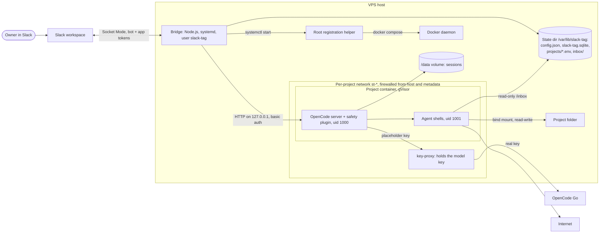

# Architecture and trust boundaries

Current snapshot: 2026-10-03, covering `main` after SEC-1 to SEC-5, Slack project registration (ONB-1, with SEC-5 isolation for registered projects), Slack commands (CMD-1) and the per-project queue. This document replaces `architecture.md` as the current picture; that file is historical. Update this file whenever a SEC item in [the backlog](backlog.md) lands.

Threat model: the agent is untrusted. It reads project files, web pages and attachments that may carry injected instructions, and it runs commands on its own. The questions here are what each component can reach and what actually stops it.

Main `49c4a42` was deployed to the VPS on 2026-10-03 Toronto (2026-10-04 UTC) with owner authorization. Registration through `#social` connected the disposable `deploy-verification` project under `/srv/slack-tag/projects`. Real Slack mention/reply, approve-once, per-thread model switching, retained session memory and queue waiting/draining passed. Live uploads, rejection and messages from two distinct users remain unverified. See [findings](findings.md) for evidence and the MiniMax response-format issue.

## Evidence labels

Every claim about enforcement carries one label:

- **Live**: checked on the VPS with real Slack (see [findings](findings.md), first live deployment).
- **Real**: checked against real OpenCode 2.0.15 or a real container, outside the VPS (Docker Desktop, Docker-in-Docker or a disposable systemd container).
- **VPS**: checked directly on the production host/container, without establishing a live Slack flow.
- **Tested**: covered by `npm run check` integration tests with simulated Slack and OpenCode.
- **Configured**: present in repo code or config, never checked at runtime.
- **Gap**: a known weakness, with the backlog item that addresses it, or **Open** when no item exists yet.

## Components

| Component | Runs as | Purpose |
| --- | --- | --- |
| Bridge (`bridge/src`) | `slack-tag` system user under `deploy/slack-tag.service`, with systemd sandboxing (**Real**, **VPS**). | Receives Slack events, maps threads to sessions, queues one run per project, streams replies, stores attachments, registers projects when onboarding is configured and accessible. |
| State directory `/var/lib/slack-tag` | `slack-tag`, `0700`, files created with umask `0027` | `config.json` (channels, owner), `slack-tag.sqlite` (thread → session), `projects/<name>.env` (registered projects' port, network and password), `inbox/<channel>/<thread>/` (uploads). |
| Credentials `/etc/slack-tag` | root, files `0600`; systemd reads `bridge.env` before dropping to `slack-tag` | `bridge.env` (Slack tokens, one password per hand-made channel), `<project>.env` (that server's password), `proxy.env` (model key). |
| OpenCode container | Starts as root, `start-server` drops the server to `node` (uid 1000); `agent-shell` runs agent shells as `agent` (uid 1001). gVisor (`runsc`) by default. | `opencode serve` with the project at `/project`, uploads at `/inbox` (read-only) and its own `/data` volume. Hand-made channels use `deploy/compose.yaml`; registered ones use `deploy/project.yaml`. |
| key-proxy container | uid 1000, read-only, no capabilities | Swaps the placeholder key for the real model key and forwards only to `https://opencode.ai/zen/go/v1`. One per registered project; one shared by hand-made projects. |
| Safety plugin (`plugin/`) | Inside the server process | Decides permission requests (policy version 3), strips secrets from agent shells, reports its policy version over RPC, and provides the `slack_attach` tool, whose files the bridge fetches over RPC, and the `/fix` command. |
| git-proxy container (optional) | uid 1000, read-only, no capabilities | Holds the host GitHub token; forwards one repository's Git traffic and, when enabled, its pull request calls. See [Git proxy](git-proxy.md). |
| Host firewall (`deploy/firewall.sh`) | root, `slack-tag-firewall.service` | Drops traffic from `st-*` bridges to `169.254.0.0/16` and to the host itself. |

One channel maps to one project and one server; each thread is one session on it. Threads in a channel share the same files, and the bridge runs one prompt or server command at a time per project. See [project mapping](project-mapping.md).

## Trust zones

1. **Owner, approvers and members**: workspace members may prompt mapped projects and run Slack commands; only the owner (`ownerUserId`) may register projects; the owner and a channel's `approvers` may approve or reject actions in that channel.
2. **Slack**: delivers events and file URLs. Trusted to say who sent a message.
3. **Bridge host**: the bridge, its state and credentials, Docker. Fully trusted.
4. **OpenCode server**: holds its own server password; trusted to enforce the plugin's decisions.
5. **Agent shells**: everything the agent runs. Untrusted. Separated from the server by uid (1001 vs 1000).
6. **Internet**: web pages, packages, the model provider. Untrusted input.

## Boundaries

### Slack → bridge

| Control | Status |
| --- | --- |
| Workspace members' messages can start or continue sessions in mapped channels. | **Tested**, **Live** for the owner path; two-user live test pending |
| Member replies in a mapped thread continue without a mention. | **Tested**, **Live** for the owner path |
| The bridge reads its workspace from `auth.test` and ignores events, approval clicks and folder choices from any other workspace. | **Tested** (SEC-3) |
| Only the owner can register a project. Approval buttons accept the owner and the users in that channel's `approvers`; anyone else, including another channel's approvers, gets a private refusal and the request stays pending. | **Tested**, **Live** for the owner path |
| Approval button values are parsed defensively and must come from the thread where the bridge asked; malformed or misplaced clicks are ignored. | **Tested** (SEC-3) |
| The bot token is sent only to `https://files.slack.com`; redirects to any other origin are refused. | **Tested** (SEC-3) |
| `/init`, `/review` or `/fix` arguments containing `` !`…` `` are sent as an ordinary prompt: a config or project command template of the same name shadows OpenCode's or the plugin's command, and runs `` !`…` `` in its arguments as a shell command on the server without asking. | **Tested** (bridge); shadowing and interpolation **Real** for `fix` and `review` |

### Bridge → Slack (output)

| Control | Status |
| --- | --- |
| Slack tokens and every channel's server password are redacted in posts, updates, ephemerals and nested block text. | **Tested** (SEC-3) |
| `<!channel>`, `<!here>`, `@everyone` and similar in agent output are neutralised. | **Tested** (SEC-3); how real Slack renders them is not verified |
| Failures post a generic message; details go to the bridge log. Registration still shows the last 500 characters of a failed step's error. | **Tested** |
| Files the agent posts with `slack_attach` go to its session's thread (a subagent's to its nearest mapped ancestor's) through Slack's external upload; the Slack SDK also sends the bot token to the upload URL Slack's API returns. Text files and captions get the same redaction; images cannot be redacted. A failed upload or an expired file posts a short note, and the run continues. | **Tested**; needs the `files:write` scope, not checked in real Slack |
| During a `/fix` run, the bridge keeps in memory the shell calls OpenCode reports for that run's own session (not its subagents): command, exit code or error, and the last 2000 characters of output, for at most the last 200 calls. When the run succeeds, fails or is interrupted, it uploads them as `fix-commands.log` with the same redaction as other text files. Unlike the progress card, it shows command text and output, so a secret the bridge does not know, such as a printed `.env` value, is not redacted. It shows what ran, not whether a check was meaningful. | **Tested**; event shapes **Real** (`spike/v2/attach.sh fix-check.mjs`); not checked in real Slack |

### Bridge → OpenCode server

| Control | Status |
| --- | --- |
| Servers listen on host `127.0.0.1` only. | **Real** (S5 `docker inspect`) |
| Basic auth with a per-project server password; the bridge refuses to start if two channels share one. | **Tested**, **Real** (SEC-5 PR #6) |
| A server that does not answer the plugin RPC with policy version 3 marks the channel unavailable, so no prompts are sent. | **Tested** |

### Bridge → host (files and Docker)

| Control | Status |
| --- | --- |
| Uploads go to the bridge-owned `<state dir>/inbox/<channel>/<thread>/` with a sanitized name, a 20 MB cap and a type check; a symlinked inbox folder is refused. The bridge no longer writes into the project or `.git/info/exclude`. | **Tested** (SEC-1) |
| A `projectDir` that is `/`, contains, or sits inside the state folder stops startup and registration. | **Tested** (SEC-1) |
| Registration only offers direct, non-symlink subfolders of `projectsRoot` with a safe name. | **Tested** |
| The bridge never writes to a project folder. `deploy/start-project.sh` prepares it as uid 1000 (not root), refuses symlinks at the paths it writes, and removes access for other users, so the bridge user can list `projectsRoot` but not open a project. | **Tested** (as root and as a normal user), **Live** preparation through systemd; symlink rejection tested |
| Registration runs `prepare-project.sh` and `docker compose` without the Slack tokens or other channels' passwords in the child environment. | **Tested** |
| The bridge runs as the dedicated `slack-tag` user with `NoNewPrivileges`, `ProtectSystem=strict`, `ProtectHome`, write access only to the state folder, and no capabilities. | **Real** (SEC-4, disposable systemd container) |
| Registration does not give the bridge Docker access (root-equivalent). With `onboarding.start: "systemd"` the bridge may only `systemctl start slack-tag-project@<name>`, allowed by a polkit rule; root then runs `deploy/start-project.sh`, which checks the bridge-written env file and passes `docker compose` only checked values. | **Tested** (PR #22), **VPS** (polkit authorization and missing-project rejection), **Live** (`#social`, `deploy-verification`) |

### Agent → its container and project

| Control | Status |
| --- | --- |
| Containers run under gVisor by default (`runsc`), so a kernel exploit hits gVisor's kernel, not the host's. `SLACK_TAG_RUNTIME=runc` is the documented fallback only where gVisor cannot be installed. | **Real** (SEC-5, gVisor in Docker-in-Docker) |
| Read-only image root, all capabilities dropped except `SETUID`/`SETGID` for the privilege drop, `no-new-privileges`, 2 GB memory, 512 processes. | **Real** (S5, SEC-5) |
| Only the project folder, its read-only inbox and its own `/data` are visible; other projects, the host and the bridge env are not. | **Real** (S5, SEC-1) |
| `.opencode/`, `opencode.json(c)`, `.git/hooks` and `.git/config` are read-only, so the agent cannot change its own policy or plant Git hooks. | **Real** (S5, runc and gVisor) |
| A per-thread worktree has its own writable `.opencode/`/`opencode.json(c)`, which the agent could create. The worktree server runs with `OPENCODE_CONFIG_PROJECT_DISABLE`, so OpenCode loads no project config or plugins from any session directory; only the trusted global config and safety plugin apply. (Tradeoff: the flag also turns off OpenCode's own AGENTS.md auto-load; the safety plugin reads AGENTS.md itself and injects it, see the next row.) | **Real** (2.0.15: a planted worktree `opencode.json` permission override and instruction are not loaded; verified without the flag it is) |
| With project config disabled, the safety plugin adds the session's own `AGENTS.md` to the system prompt (#57), so worktree threads keep the project's instructions. It reads the file once at startup, as the agent user, through the same guarded path as `slack_attach`: the real path must equal `<session>/AGENTS.md`, so a symlink (to a server-only file per #51, or anywhere outside) is refused, and the read is capped at 32 KiB. It injects nothing when the flag is off (OpenCode already auto-loads it, so no double) or when the file is missing, oversized or not text. | **Real** (2.0.15, `spike/v2/agents.sh`: with the flag, the plugin's AGENTS.md reaches the model's system prompt; a no-plugin control on the same project confirms OpenCode does not auto-load it under the flag), **Tested** (`tests/agents.integration.test.ts`: injected when disabled, absent when enabled, symlinked/oversized/missing files not read) |
| A worktree uses the main repo's read-only `.git/config` and hooks via its commondir, and `extensions.worktreeConfig` stays off, so the agent cannot re-enable per-worktree config. | **Real** (2.0.15 `git rev-parse --git-common-dir`, `config extensions.worktreeConfig`) |
| A worktree's `.git` file and commondir are writable, so the agent could point the server's git at a config that runs a command (`core.fsmonitor`, `core.hooksPath`, a clean filter, `diff.external`) as the server (uid 1000). Two controls: the policy denies editing `.git`/`.git/worktrees/`, so the no-approval edit tool cannot redirect them; and the server forces `core.fsmonitor=false`/`core.hooksPath=/dev/null` via `GIT_CONFIG_*` (command-level precedence) over any repo or redirected config (OpenCode's own VCS also passes `-c core.fsmonitor=false`). | **Real** (git 2.43: an `fsmonitor` command runs on the server's `git status` without the override, not with it), **Tested** (policy denies the redirect edits). Residual: an owner-approved shell write could still redirect, leaving a clean filter on the server's `git diff`/`git add` as a follow-up. |
| `.git/commondir` is a read-only `.` placeholder, so the agent cannot point the server's Git at a planted config with filter programs (#52). Git 2.43 works normally with it (status, diff, add, commit, stash, gc, fsck, worktrees). | **Tested** (real Git, disposable repo); **Real** (git 2.43, uid 1000/1001 two-user check over real bind mounts, #60); real container/gVisor mount still pending |
| Renaming or deleting `.git` to slide the read-only mounts aside and plant a fresh writable one is blocked two ways (#60). The policy denies agent shell commands that move, copy or delete a `.git` path (`mv`/`cp`/`rm`/`rmdir`/`unlink`) or redirect (`>`/`>>`) into `.git`. Independently, `.git` is its own bind **mount point**, so the kernel refuses `mv`/`rmdir`/`rm -rf`/`mkdir` on it with `EBUSY`/`EEXIST` for the agent and root alike, even from a script, while Git still writes objects, refs, index and worktrees. | **Tested** (policy denials and Git still allowed); **Real** (git 2.43 over real bind mounts, server uid 1000 / agent uid 1001, reproduced the bypass then confirmed the fix); **Configured** (`deploy/compose.yaml`, `deploy/project.yaml` `.git` mount); real container/gVisor not yet run |
| Other files in `.git/` (`info/attributes`, `objects/info/alternates`, refs) remain writable from agent shells. They cannot name a program without a writable `config`/`hooks`/`commondir`, which stay read-only and can no longer be moved aside (#60). | **Gap**: #52/#60 follow-up — mount or rewrite these read-only too |
| Agent shells run as `agent` (uid 1001), so they cannot read the server's environment, memory or `/data`, and cannot approve their own permission requests. | **Real** (SEC-5) |
| Everything else in the project, including `.env` files and `.git` history, is writable by the agent. | By design; damage is unrecoverable (**Gap**: SEC-6) |
| No CPU or disk limits. | **Gap**: SEC-5 follow-up |

### Agent → actions (safety plugin and config)

| Control | Status |
| --- | --- |
| Policy version 3: reads, project edits and a named list of shell commands run without asking when every command OpenCode sends is safe (it sends one resource per command of a chain, pipeline or background job). The list covers harmless output redirections, `$?`, read-only Git, plain `git pull` (fast-forward only) and `curl` to localhost without file, proxy or redirect flags. Everything else, including redirection to files, substitutions, other `curl` and web access, asks the owner in Slack. See `SPEC.md`. | **Tested**, **Real** (SEC-2, #38, and #40 with `spike/v2/policy.sh`) |
| Always refused: force pushes (also with `2>&1` before the flag), `sudo`/`su`/`doas`, download-and-run (also from localhost), edits to protected config or anywhere in `.git` (normalized, so `..` cannot escape the check), and shell commands that move, copy, delete or redirect into a `.git` path (#60). Git's own subcommands are unaffected. | **Tested** (SEC-2, #40, #52, #60) |
| No answer within the timeout, a plugin error, or a missing plugin never allows. | **Tested** (SEC-2) |
| Requests from subagent sessions go to the nearest mapped ancestor's thread; requests with no mapped ancestor are rejected at once. | **Tested** (SEC-2) |
| Subagent permission requests are not re-posted after a bridge restart. | **Gap**: SEC-2 follow-up |

### Agent → secrets

| Control | Status |
| --- | --- |
| No Slack tokens in containers. | **Real** (S5) |
| The real model key lives only in `key-proxy`; project containers get the placeholder `unused`. | **Real** (SEC-5 PR #6) |
| Agent shells get no server password or `SLACK_` variable, and as uid 1001 cannot read the server's `/proc/<pid>/environ`. | **Real** (S1, S2, SEC-5) |
| Built-in read, list, glob and grep tools run in the server process (uid 1000), so the plugin refuses them without asking when the path resolves (after `..`, relative paths and existing symlinks) under `/proc` (the server's environment) or `/data` (the server's `HOME` and session store). This covers `external_directory` requests there and grep over a parent such as `/`. Other external folders still ask. | **Tested**, **Real** (#51, OpenCode 2.0.15 outside a container) |
| The agent can still use its project's key proxy to spend inference. | By design |
| `slack_attach` needs no approval (OpenCode does not consult the permission hook for plugin tools). It reads through `agent-shell` as uid 1001 with a bare environment, so it posts only what the agent could read itself: a regular file of an allowed type (images checked by signature, text without NUL bytes), at most 10 MB, under the session folder, `/project` or `/tmp`, with no symlink on its path. The bridge never opens the project: it fetches each file once over the password-protected plugin RPC, only for the session that attached it, within 10 minutes. | **Real** (`spike/v2/attach.sh`; the image's users and capabilities reproduced in a mount namespace, not the Docker image or gVisor) |

### Agent → network

| Control | Status |
| --- | --- |
| Each project has its own Docker network: `st-alpha`, `st-beta` (172.30.x.0/24) for hand-made projects, `st-reg-<n>` (172.31.n.0/24) for registered ones. Projects cannot reach each other. | **Real** (SEC-5) for hand-made; **Configured** for registered |
| `deploy/firewall.sh` drops traffic from `st-*` networks to the cloud metadata range `169.254.0.0/16` and to the host itself; replies to the bridge's own connections still pass. | **Real** (SEC-5, Docker-in-Docker) |
| Other internet access stays open by decision (no egress allowlist). | By design (SEC-5, 2026-10-02) |

### Agent → browser (screenshots)

| Control | Status |
| --- | --- |
| `playwright screenshot` runs without approval only for an `http(s)://` URL on `localhost`, `127.0.0.1` or `[::1]`, with `--full-page`, `--viewport-size=`, `--wait-for-selector=`, `--wait-for-timeout=` or `--timeout=`, saving a `.png` under `/tmp` or the working folder (no `..` or dot folders). Other hosts, `file://`, other flags (`--save-har`, `--user-data-dir`, `--channel`, `-b`), other subcommands, `npx` or a path to another binary ask. The agent is told to use `/tmp` so screenshots are not committed. | **Tested**; **Real** (OpenCode 2.0.15 with the plugin and a scripted model) |
| The browser is the image's root-owned Chromium headless shell, started through `agent-shell` as uid 1001 with no capabilities, so it reads and writes only what the agent can. Playwright runs it with `--no-sandbox` and `--disable-dev-shm-usage` (shared memory in the `/tmp` tmpfs); no capability, seccomp or `/dev/shm` change. | **Real** (runc, stand-in image with the compose flags); gVisor and the built image **Configured** |
| The localhost check is not an egress boundary: a local page can load other sites, and the CLI opens a local file named like the URL as `file://` instead. Neither gives more than project code run by `npm test` already has. | By design (egress open, SEC-5) |

### Agent → GitHub (Git proxy)

| Control | Status |
| --- | --- |
| The agent container gets Git URL rewrites and `GIT_PROXY_URL`, never a token. The proxy forwards Git smart HTTP for its one repository; pushes need `GIT_ALLOW_PUSH=1`. | **Live** for fetch and push (2026-10-14, see findings); `GIT_PROXY_URL` **Configured**; Git coverage is issue #36 |
| With `GIT_ALLOW_PULL_REQUESTS=1` the proxy also allows reading the default branch, finding the open pull request for a `jeff/*` head and opening one from a `jeff/*` head into a different base, forwarding only title, body, head and base. Other repositories, endpoints, query parameters and fields are refused. | **Tested**; **Real** through OpenCode 2.0.15 with a fake GitHub |
| Caller credentials are replaced, redirects are not followed, bodies are capped at 64 KiB, GitHub errors become a generic `502` and replies keep only the default branch, pull request URL and number, so neither the token nor a temporary clone token reaches the agent or the logs. | **Tested** |
| `open_pull_request` asks no one, because plugin tools never reach the permission hook. Its branch checks are a convenience; the proxy is the boundary, since the agent can call it directly. Pull requests are authored by the host account and may run the repository's pull request workflows, as pushes already can. | **Real**; by design |

## Secrets inventory

| Secret | Stored in | Who can read it |
| --- | --- | --- |
| Slack bot and app tokens | `/etc/slack-tag/bridge.env` | root, the bridge process |
| Model key (`OPENCODE_API_KEY`) | `/etc/slack-tag/proxy.env` | root, the key-proxy containers |
| Host GitHub token | The host `gh` login, read at startup into the git-proxy container's environment | root, Docker, the git-proxy container |
| Hand-made channel server passwords | `bridge.env` (as each channel's `passwordEnv`) and that project's env file | root, the bridge, that project's server (uid 1000) |
| Registered project server passwords | `<state dir>/projects/<name>.env`, `0600` | The bridge user, that project's server |
| Thread → session map | `slack-tag.sqlite` | The bridge user (state folder `0700`) |
| Conversation history | Each container's `/data` volume | That project's server (not its agent shells); root |

## VPS verification

Verified on 2026-10-03 (**VPS**); details and limits are in [findings](findings.md):

- From an agent shell: `id` shows uid 1001, `/proc/1/environ` is unreadable, `169.254.169.254` and the host's address are unreachable, and the key proxy answers.
- `docker inspect` shows `runsc` for every project container and an `st-` bridge name for every project network.
- The bridge runs as `slack-tag`; `systemctl start slack-tag-project@<name>` works for it, while any other unit or `stop` is denied.

The initial helper test used a missing project and an invalid unit name. Release `49c4a42` then completed real Slack registration of `deploy-verification` through systemd; its container uses `runsc` and a read-only root. A real Slack prompt ran `id` after approve-once and reported uid 1001. Live uploads, rejection and two-user messaging remain pending; registered cross-project network isolation still needs a direct connectivity test.
