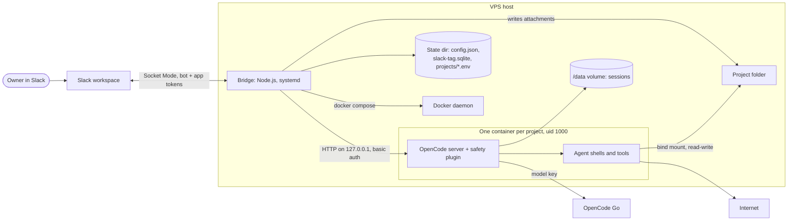

# Architecture and trust boundaries

Current snapshot: 2026-10-02, covering `main` plus Slack project registration (ONB-1). This document replaces `architecture.md` as the current picture; that file is historical. Update this file whenever a SEC item in [the backlog](backlog.md) lands.

Threat model: the agent is untrusted. It reads project files, web pages and attachments that may carry injected instructions, and it runs almost every command without approval. The questions here are what each component can reach and what actually stops it.

## Evidence labels

Every claim about enforcement carries one label:

- **Live**: checked on the VPS with real Slack (see [findings](findings.md), first live deployment).
- **Real**: checked against real OpenCode 2.0.15 or a real container, outside the VPS (see [findings](findings.md)).
- **Tested**: covered by `npm run check` integration tests with simulated Slack and OpenCode.
- **Configured**: present in repo code or config, never checked at runtime.
- **Reported**: stated in deployment notes; the VPS was not inspected.
- **Gap**: a known weakness, with the backlog item that addresses it.

## Components

| Component | Runs as | Purpose |
| --- | --- | --- |
| Bridge (`bridge/src`) | Host process under systemd. Committed unit sets no `User=`, so root; the VPS overrides it to `devuser`, uid 1000 (**Reported**). | Receives Slack events, maps threads to sessions, streams replies, stores attachments, registers projects. |
| State directory `/var/lib/slack-tag` | Bridge's user | `config.json` (channels, owner, per-project passwords), `slack-tag.sqlite` (thread → session), `projects/<name>.env`. |
| Credentials `/etc/slack-tag` | root, files `0600` (**Reported**) | `bridge.env` (Slack tokens, shared server password), `opencode.env` (model key, shared server password). |
| OpenCode container | uid 1000, one per project | `opencode serve` with the project at `/project` and its own `/data` volume. Fixed channels use `deploy/compose.yaml`; registered ones use `deploy/project.yaml`. |
| Safety plugin (`plugin/`) | Inside the server process | Decides permission requests, strips secrets from agent shells, reports its policy version over RPC. |

One channel maps to one project and one server; each thread is one session on it. Threads in a channel share the same files. See [project mapping](project-mapping.md).

## Trust zones

1. **Owner**: the only Slack user the bridge acts for (`ownerUserId`).
2. **Slack**: delivers events and file URLs. Trusted to say who sent a message.
3. **Bridge host**: the bridge, its state and credentials, Docker. Fully trusted.
4. **Agent container**: the OpenCode server and everything the agent runs. Untrusted, because the agent and the server share a uid.
5. **Internet**: web pages, packages, the model provider. Untrusted input.

## Boundaries

### Slack → bridge

| Control | Status |
| --- | --- |
| Only the owner's messages start or continue sessions; others get an ephemeral refusal and no session is created. | **Tested**, **Live** for the owner path |
| Owner replies in a mapped thread continue without a mention. | **Tested**, **Live** |
| Only the owner can register a project or click approval buttons. | **Tested** (register), **Configured** (approvals) |
| No check that events come from the expected workspace (`team_id` defaults to `""`). | **Gap**: SEC-3 |
| Approval button values are parsed with an unguarded `JSON.parse` and not matched to the clicked channel or thread. | **Gap**: SEC-3 |
| The bot token is sent to whatever `url_private` an event names, following redirects. | **Gap**: SEC-3 |

### Bridge → Slack (output)

| Control | Status |
| --- | --- |
| Slack token patterns are redacted from posted and updated messages. | **Tested** |
| Redaction misses the model key and server passwords, ephemeral messages, and nested block text. | **Gap**: SEC-3 |
| Error text, including the last 500 characters of `docker compose` stderr during registration, is posted to Slack. | **Gap**: SEC-3 |
| Agent output can contain `<!channel>` or `<!here>` and ping the channel. | **Gap**: SEC-3 |

### Bridge → OpenCode server

| Control | Status |
| --- | --- |
| Servers listen on host `127.0.0.1` only. | **Real** (S5 `docker inspect`) |
| Basic auth with a server password. Fixed channels share one password; registered projects each get a random 48-hex password. | **Tested** (registration), **Live** (shared password) |
| A server that does not answer the plugin RPC with policy version 2 marks the channel unavailable, so no prompts are sent. | **Real** (S2), **Tested** |

### Bridge → host (files and Docker)

| Control | Status |
| --- | --- |
| Attachments are written to `<project>/.slack-tag/inbox/<thread>/` with a sanitized name, a 20 MB cap and a type check. | **Real**, **Tested** |
| The inbox path check is textual and ignores symlinks; the agent can redirect the next upload, or the `.git/info/exclude` append, to any file the bridge user can write. | **Gap** (reproduced locally): SEC-1 |
| Registration only offers direct, non-symlink subfolders of `projectsRoot` with a safe name. | **Tested** |
| Registration runs `prepare-project.sh` and `docker compose` as the bridge user, without the Slack tokens or shared password in the child environment. | **Tested** |
| Docker access is root-equivalent, so the bridge user effectively has root on the host. | **Gap**: SEC-4 |
| `projectDir` is not validated against `/` or the state directory. | **Gap**: SEC-1 |

### Agent → its container and project

| Control | Status |
| --- | --- |
| Non-root uid 1000, read-only image root, all capabilities dropped, `no-new-privileges`, 2 GB memory, 512 processes. | **Real** (S5), **Configured** on the VPS |
| Only the project folder is visible from the host; other projects, the host and the bridge env are not. | **Real** (S5) |
| `.opencode/`, `opencode.json(c)`, `.git/hooks` and `.git/config` are read-only, so the agent cannot change its own policy or plant Git hooks. | **Real** (S5, runc and gVisor) |
| Everything else in the project, including `.env` files, `.git` history and the attachment inbox, is read-write. | By design; damage is unrecoverable (**Gap**: SEC-6) |
| gVisor runs only when `SLACK_TAG_RUNTIME=runsc`; the VPS runtime was not recorded. | **Gap**: SEC-5 |

### Agent → actions (safety plugin and config)

| Control | Status |
| --- | --- |
| Policy version 2 allows everything automatically, so the Slack approval flow is never triggered. | **Real** |
| Denied: shell commands whose first word is `sudo`, edits to protected config paths, and `git push *` (global config). | **Real** |
| Those denies are text matches; `bash -c 'sudo …'`, `git -C . push` or a script bypass them. Destructive commands such as `rm -rf` or `git reset --hard` run without asking. | **Gap**: SEC-2 |
| If the plugin throws at runtime, the base config is allow-all. | **Gap**: SEC-2 |
| Permission requests from subagent sessions are dropped, because their session is not mapped to a thread. | **Gap**: SEC-2 |

### Agent → secrets

| Control | Status |
| --- | --- |
| No Slack tokens in containers. | **Real** (S5) |
| Agent shells get no model key, server password or `SLACK_` variable. | **Real** (S1, S2 with the real Go model) |
| The server process holds the model key and its password, and the agent shares its uid, so `/proc/1/environ` exposes both. | **Gap**: SEC-5 |

### Agent → network

| Control | Status |
| --- | --- |
| Outbound traffic is unrestricted: no egress allowlist, no block on the cloud metadata address or host services. | **Gap**: SEC-5 (unverified on the VPS) |
| Fixed services (`alpha`, `beta`) share one Compose network, and with the shared password one agent could drive the other's server. Registered projects get their own network and password. | **Configured**; **Gap** for fixed services: SEC-5 |

## Secrets inventory

| Secret | Stored in | Who can read it |
| --- | --- | --- |
| Slack bot and app tokens | `/etc/slack-tag/bridge.env` | root, the bridge process |
| Model key (`OPENCODE_API_KEY`) | `/etc/slack-tag/opencode.env` | root; every OpenCode server process, and therefore every agent via `/proc` |
| Shared server password | Both env files | root, the bridge, fixed-service servers and their agents |
| Per-project server passwords | `config.json` and `projects/<name>.env`, both `0600` | The bridge user; that project's server and agent |
| Thread → session map | `slack-tag.sqlite` | The bridge user; the state dir is created `0755` and the database with the default umask (**Gap**: SEC-4) |
| Conversation history | Each container's `/data` volume | That project's server and agent; root |

## Pending changes not yet reflected

- `feat/key-proxy` moves the model key into a separate proxy container (part of SEC-5). Not merged.
- `feat/project-queue` runs one prompt at a time per project. Not merged.
- `feat/slack-commands` runs OpenCode commands from Slack mentions (CMD-1). Not merged.
